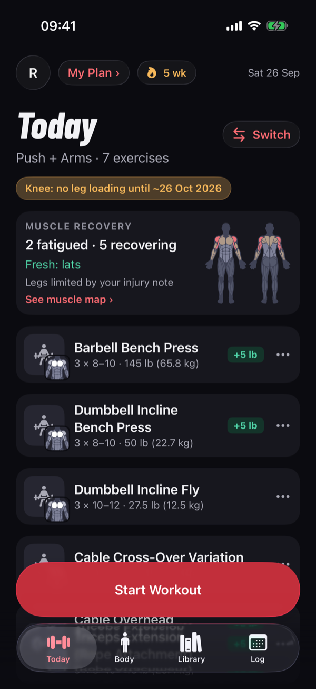
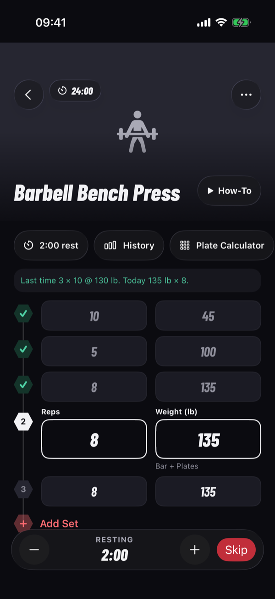
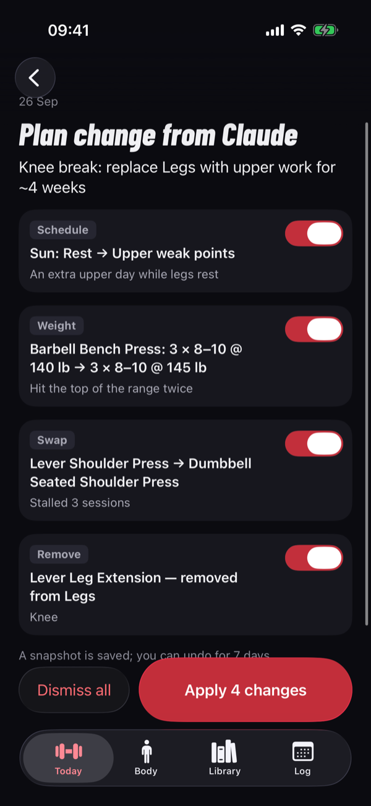
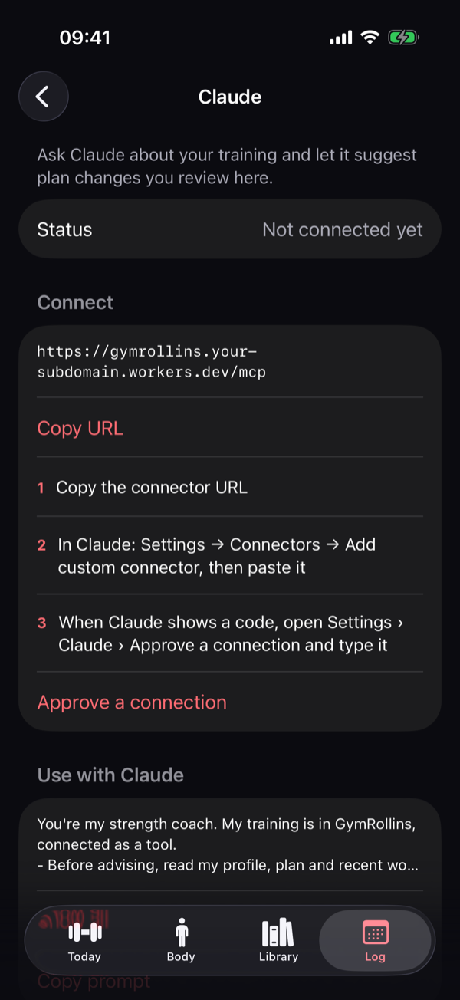
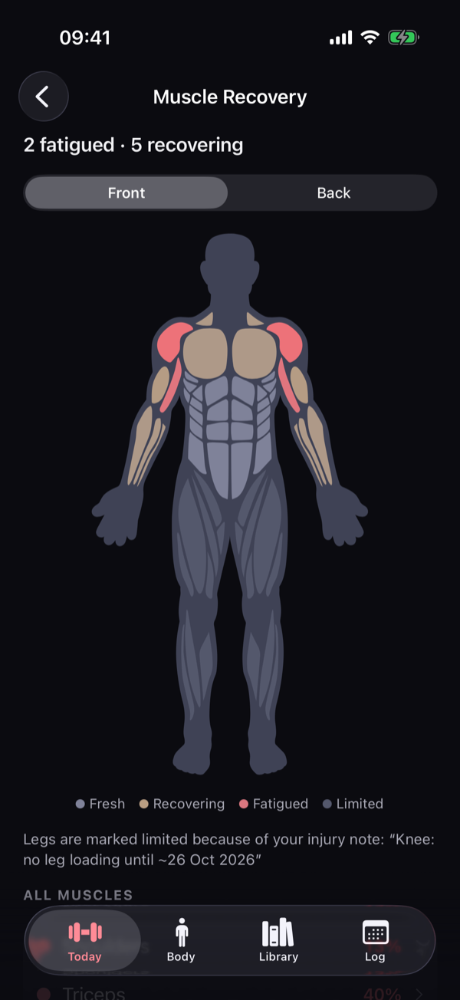
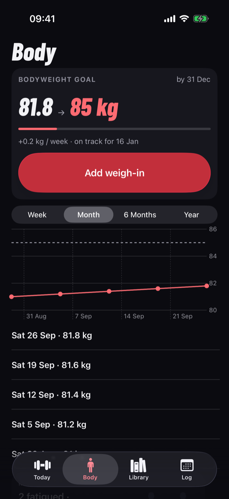
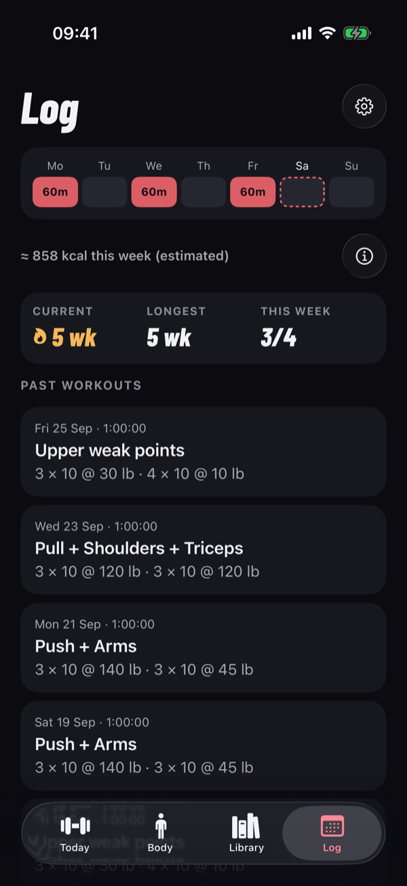

# GymRollins

**An open-source, native iPhone and Apple Watch gym tracker that Claude can read and plan with, through MCP.**

<table>
  <tr>
    <td align="center"><br><sub>Today's plan</sub></td>
    <td align="center"><br><sub>Logging a workout</sub></td>
    <td align="center"><br><sub>Claude proposes, you approve</sub></td>
    <td align="center"><br><sub>Connect Claude via MCP</sub></td>
  </tr>
  <tr>
    <td align="center"><br><sub>Muscle recovery</sub></td>
    <td align="center"><br><sub>Bodyweight goal</sub></td>
    <td align="center"><br><sub>History and streaks</sub></td>
    <td></td>
  </tr>
</table>

<sub>Screenshots use the app's built-in demo data. Regenerate them with `scripts/readme-screenshots.sh`.</sub>

## Why I built it

I wanted an AI coach that knows my real training: every set, every weight, every skipped day. For that I needed a
native iOS workout app with an **MCP server**, so Claude could read my history directly and help plan the next
weeks. I couldn't find one.

So I built my own: a fast, native SwiftUI app for logging in the gym, with a remote MCP server that lets Claude
read your training and **propose** plan changes. Claude never edits your plan directly; you review each proposal
in the app and apply it with one tap.

Now I'm open-sourcing it so we can build it together. If you've also been looking for an AI-ready workout app,
try it, open an issue, or send a pull request.

## What it does

- **Plan and log workouts.** Routines on a weekly schedule, weight suggestions from a progression engine, plate
  rounding, rest timer, supersets, and a one-tap "reps left" effort rating.
- **Claude as your coach, via MCP.** Add GymRollins as a custom connector in Claude (OAuth 2.1 with dynamic client
  registration, no API keys to copy). Claude's sign-in page shows a code; you approve it in the app under Settings ›
  Claude › Approve a connection. Claude reads your history and proposes changes; you approve them in the app.
  With the Gyms toggle on, it also reads the equipment at your gyms.
  It gets the rules for the tools when it connects, and Settings › Claude has one prompt to paste into a Claude
  Project; after that you just ask.
- **Apple Watch.** Log sets from the wrist, rest timer with haptics, heart rate during the workout.
- **Apple Health.** Workouts and weigh-ins go to Health; body weight comes back from it.
- **Insights.** Muscle recovery map, weekly sets per muscle, streaks, and strength levels compared with
  OpenPowerlifting data.
- **Train with what's actually there.** Keep a photo catalogue of each gym's equipment, no account needed. Today's
  plan swaps what this gym can't do for that session only, weights snap to the bells and stacks that exist, and Build
  workout makes a session from what's there. An item with no photo shows a sample until you add yours. Sign in to see
  what people have shared at a gym, share your own or confirm theirs. Anything marked This phone only never leaves the
  phone. Shared listings can be reported, and their authors blocked; three reports hide a listing until a moderator
  decides.
- **Train with a partner.** Share a day's workout by QR code or link. Your partner opens it with their own weights, and each
  of you logs on your own phone. No account or signal needed.
- **Injury notes with an end date.** On the date, Today asks if it's time to continue, and brings a paused routine back at
  60% of its weights.
- **Bring your history.** CSV import from Fitbod, Strong, Hevy and FitNotes.
- **Offline-first.** Everything lives on the device (SwiftData); sync with the GymRollins API, one Cloudflare Worker,
  is optional.

## Status

Early, and built for one user first (me). It runs today on the simulator or your own iPhone, against a local
Cloudflare Worker (`scripts/server-up.sh`; no Docker, no Cloudflare account). Deploying the Worker and an App Store
release are next: see `docs/cloudflare-checklist.md` and `docs/release-readiness.md`.

## Build it with me

Good places to start:

- More importers (other apps' CSV exports) and better exercise matching.
- New MCP tools for Claude: what would you want your AI coach to read or propose?
- Exercise photos and media with clear licenses.
- Apple Watch and Apple Health features, accessibility, and translations.

Open an issue to discuss an idea first, or pick an existing one. Contributions need a one-time CLA signature; see
[CONTRIBUTING](.github/CONTRIBUTING.md).

## Developer docs

Native SwiftUI iOS app + one Cloudflare Worker (Hono, Better Auth, D1, R2) that serves sign-in, sync, photos and the
remote MCP server. Offline-first: SwiftData is the source of truth on the device and sync is best-effort. Claude
reads training data and *proposes* plan changes through MCP; it never edits the plan directly. The owner applies
proposals in the app (or opts in to auto-apply).

- Spec: `docs/specs/2026-09-26-gymrollins-ios-design.md`; the backend: `docs/specs/2026-11-07-cloudflare-backend-design.md`
- Plans: `docs/plans/`
- Server: `server/README.md`
- Mockups: `docs/design/`
- Release readiness: `docs/release-readiness.md`: what works locally, what needs the deploy, what's deferred, owner
  decisions needed, install instructions
- Deploy checklist: `docs/cloudflare-checklist.md`: the owner's steps to deploy the Worker and move the phone to it,
  each approved separately
- Flow-map test coverage: `docs/testing/flow-coverage.md`
- Performance baselines: `docs/testing/performance.md`

## Architecture

```
iPhone app ──(session token)──▶ /api/auth/*   Better Auth (Apple id token, sessions; email in debug builds only)
           ──(session token)──▶ /v1/*         sync, gyms, photos, moderation, Claude settings, account
Claude     ──(OAuth token)────▶ /mcp          MCP server, the 15 tools
           ──(browser)────────▶ /api/auth/oauth2/*, /connect, /.well-known/*
Public     ───────────────────▶ /photos/shared/*, /photos/exercises/*
                                        │
                     one Worker (Hono, TypeScript) ── D1 `gymrollins` · R2 ×3
```

On the phone: GymCore (pure Swift rules) → GymData (the SwiftData store, repositories, sync state) → GymSync
(`SyncEngine`, `ApiClient`, `AuthService` with a Keychain session) → the SwiftUI features.

| Package / dir | What lives there |
|---|---|
| `ios/GymRollins/` | App target: entry point, `Features/*` (SwiftUI screens), `DesignSystem/*` (Liquid Glass components, tokens), `Resources/` (exercise library JSON, fonts) |
| `ios/GymRollinsTests/`, `ios/GymRollinsUITests/` | App-level unit + XCUITest E2E suites |
| `ios/Packages/GymCore/` | Pure Swift domain: models, progression engine, 1RM, plate rounding, CSV import (Fitbod, Strong, Hevy, FitNotes behind `WorkoutImporter`; plan 13), plan-change validation — no I/O |
| `ios/Packages/GymData/` | SwiftData schema, repositories, `SyncStore` (sync state, and the server move) |
| `ios/Packages/GymSync/` | `ApiClient`, `ApiSyncTransport`, `ApiGymCatalogTransport`, `AuthService` (Keychain session), `SyncEngine`, DTOs; fakes for tests |
| `ios/Packages/GymHealth/` | Apple Health: `HealthStore` seam (HealthKit + fake), workout/weigh-in export, body import (plan 15) |
| `ios/Packages/GymWatchLink/` | Phone ↔ Apple Watch link (plan 17): versioned WatchConnectivity messages, the watch's view model, Digital Crown stepping, single-Health-workout rules — Foundation only, builds for watchOS 10 |
| `ios/GymRollinsWatch/` | Apple Watch app (watchOS 10, `com.rollins.gymrollins.watchkitapp`): live set + Log set, rest timer with haptic, `HKWorkoutSession` heart rate. See "Apple Watch" below |
| `server/` | The Cloudflare Worker: `src/` (Hono routes, Better Auth, sync, gyms, photos, moderation, Claude and the MCP server), `migrations/` (D1), `test/` (Vitest in workerd). See `server/README.md` |
| `web/share/` | The workout-link page, for when the app doesn't open a link (static, makes no requests) |
| `scripts/` | Everything below — the local Worker, test runners, one-off generators |

MCP: a remote Streamable-HTTP MCP server on the Worker (`server/src/mcp`), behind Better Auth's OAuth provider with
dynamic client registration (Claude registers itself; no API key to copy). AI writes go through **proposals**: Claude
calls MCP tools to read training data and create a proposal; the owner reviews and applies it in the app (or turns on
auto-apply). A connection is never approved automatically — see "Claude's connection" below.

## Quick start

```sh
# 1. The local API: one Cloudflare Worker with a local D1 and R2 (no Docker, no Cloudflare account)
cp server/.dev.vars.example server/.dev.vars
sed -i '' "s/^BETTER_AUTH_SECRET=.*/BETTER_AUTH_SECRET=$(openssl rand -hex 24)/" server/.dev.vars
scripts/server-up.sh                          # http://127.0.0.1:8787; Ctrl-C stops it, the local data stays

# 2. Generate the Xcode project and run the app (needs Xcode 26.3+, iOS 26 SDK)
cd ios && xcodegen generate
open GymRollins.xcodeproj   # run on the iPhone 17 Pro simulator, or see docs/release-readiness.md
                             # "How to install on your iPhone" for a physical device

# 3. Run the tests that need no server
scripts/ios-test.sh
```

Sync isn't required to use the app — SwiftData is the offline source of truth and the app works fully offline.
`Local.xcconfig` (gitignored, `ios/Config/`) overrides the defaults in `Base.xcconfig`: a signing team and, once the
owner deploys the Worker, its https `API_URL` (see `docs/cloudflare-checklist.md`).

## Test

| Suite | Command |
|---|---|
| Everything (opt-in end-to-end suites, each on a throwaway local Worker: `SYNC_E2E=1`, `MCP_E2E=1`, `PHOTO_E2E=1`, `GYM_E2E=1`) | `scripts/test-all.sh` |
| API server (Vitest in workerd with in-memory D1 and R2: sync, gyms, photos, moderation, account deletion, the MCP tools, Claude's OAuth and `/connect`, the domain-limits drift test) | `cd server && npx vitest run && npx tsc --noEmit` |
| GymCore unit tests | `cd ios/Packages/GymCore && swift test` |
| GymCore coverage (≥ 90%) | `scripts/coverage-gymcore.sh` |
| Equipment requirements mapping (writes `equipment-requirements.json` and its review file) | `node --test scripts/map-equipment-requirements.test.mjs && node scripts/map-equipment-requirements.mjs` |
| GymData unit tests | `cd ios/Packages/GymData && swift test` |
| GymSync unit tests (fake transport, stub URL protocol) | `cd ios/Packages/GymSync && swift test --filter GymSyncTests` |
| iOS app unit + UI tests | `scripts/ios-test.sh` |
| GymHealth unit tests (fake Health store) | `cd ios/Packages/GymHealth && swift test` |
| GymWatchLink unit tests (messages, crown, Health dedupe rules, watch view model) | `cd ios/Packages/GymWatchLink && swift test` |
| Apple Watch app builds (watchOS simulator + device, unsigned; no watchOS runtime needed) | `scripts/watch-build.sh` |
| Workout link page (no requests, content security policy, Apple's domain file) | `node --test web/share/share.test.mjs` |
| Exercise photo matcher (free-exercise-db mapping) | `node --test scripts/map-exercise-photos.test.mjs` |
| wger photo + other-language name mapper (per-item CC licenses, provenance policy; review: `docs/import/wger-review.md`) | `node --test scripts/map-wger.test.mjs` |
| Strong / Hevy / FitNotes alias tables (ids exist, no key collisions, every override explained; review: `docs/import/other-apps-alias-review.md`) | `node --test scripts/other-apps-alias-report.test.mjs` |
| Body-map extractor (react-native-body-highlighter paths → `Resources/body-map.json`) | `node --test scripts/build-body-map.test.mjs` |
| Strength-standards builder (OpenPowerlifting CSV → `Resources/strength-standards.json` + the server's copy in `server/src/shared/`; regenerate: `docs/licenses/openpowerlifting.md`) | `node --test scripts/build-strength-standards.test.mjs` |
| Photo prompts + Gemini photo generator (mocked fetch, no API calls; how to run it: `docs/media/README.md`) | `node --test scripts/build-photo-prompts.test.mjs scripts/generate-photos.test.mjs` |
| Photo uploader (a fake Worker and a fake wrangler; no network) | `node --test scripts/upload-photos.test.mjs` |
| Seed generators (the D1 seeds match the bundled JSON) | `node --test scripts/gen-equipment-seed.test.mjs && node scripts/gen-equipment-seed.mjs --check && node scripts/gen-exercise-seed.mjs --check` |
| Store comparison for the server-move check | `node --test scripts/compare-stores.test.mjs` |
| GymSync integration tests on a throwaway local Worker (port 8788, its own state, removed afterwards); verifies account deletion leaves no rows | `scripts/test-sync-integration.sh` |
| Shared gyms E2E: two users, photo rules, and a check that "This phone only" stays off the server, on a throwaway Worker | `scripts/test-gym-e2e.sh` |
| Photo hosting E2E (upload script → local R2 → manifest → app provider) | `scripts/test-photo-hosting.sh` |
| Claude's connection over HTTP (discovery, registration, `/connect`, approval, tokens, MCP, refresh, Disconnect) on a throwaway Worker | `scripts/test-mcp.sh` |
| iOS sync and Claude UI tests (`SyncUITests`, `ProposalSyncUITests`) on a throwaway Worker | `scripts/ios-test-sync.sh` |
| The server-move check with a copy of a phone's store (kept outside the repo) | `scripts/server-move-check.sh <phone-backup-dir> <work-dir>` |
| Performance baselines (not in test-all; GymData repository timings + iOS launch/scroll metrics, release build + simulator) | `scripts/test-perf.sh [data\|ui]` — see `docs/testing/performance.md` |

## Apple Watch

A companion watch app (plan 17, `docs/plans/2026-09-30-plan-17-watch.md`) for **watchOS 10+** (the owner's Series 5
runs watchOS 10.6.1). The iPhone stays the source of truth: while a workout runs on the phone, the watch shows the
next set ("Set 3/5 · 135 lb × 8"), rest countdown (haptic at 0), workout clock and heart rate; it can Log set (Digital
Crown adjusts weight by the phone's plate/dumbbell increment, and reps), +30s / Skip rest, move between exercises, and
start today's workout. The watch's `HKWorkoutSession` saves the Health workout (heart rate, measured energy) and the
phone then doesn't export its own copy — one Health workout per workout.

**Install on the watch** (needs Xcode signed in with the team's Apple ID, and the watchOS platform installed in Xcode →
Settings → Components — ~5 GB, required to deploy to any watch):

```sh
cd ios && GYM_EMBED_WATCH=YES xcodegen generate   # embeds the watch app in the iPhone app (off by default)
open GymRollins.xcodeproj
```

Run the `GymRollins` scheme on the iPhone paired with the watch; then on the iPhone open the Watch app → My Watch →
Available Apps → GymRollins → Install (or run the `GymRollinsWatch` scheme on the watch directly). Open GymRollins on
the watch once to allow Health access. Without `GYM_EMBED_WATCH=YES` the project builds and tests without the watchOS
platform (Xcode refuses to build a scheme with an embedded watch app when it's missing).

## Claude's connection

Claude connects to GymRollins as an OAuth 2.1 client of the Worker (Better Auth's `@better-auth/mcp` plugin):

1. Claude calls `/mcp`, gets a 401 that points at `/.well-known/oauth-protected-resource/mcp`, and reads the
   authorization server's metadata.
2. It registers itself (dynamic client registration) and opens the authorize step with PKCE.
3. The browser lands on `/connect`, a plain HTML page from the Worker (strict Content-Security-Policy, no script). It
   shows a code, `XXXX-XXXX`, and which Claude is asking.
4. In the app: Settings › Claude › **Approve a connection**, type the code, check the client and its address, then
   Approve or Deny. Codes expire in 10 minutes and work once, each account gets 5 wrong tries per 10 minutes, and only
   the browser that showed the code can continue.
5. The page returns to Claude with an authorization code. Claude's tokens are opaque and checked in D1 on every call,
   and refresh tokens rotate. **Disconnect Claude** removes every grant and token at once.

Locally, with `scripts/server-up.sh` running:

```sh
node scripts/claude-local.mjs smoke                 # the whole flow as Claude would run it
claude mcp add --transport http --scope local gymrollins-local http://127.0.0.1:8787/mcp   # Claude Code
node scripts/claude-local.mjs approve XXXX-XXXX     # approve the code /connect shows, as the dev account
```

claude.ai needs the deployed Worker's https address: `docs/cloudflare-checklist.md`, step 11.

## License

GymRollins is open source under the [GNU AGPLv3](LICENSE)

- Everything is AGPLv3 except files marked `@license Pro` at the top. Those are under the GymRollins
  Commercial License (end of [LICENSE](LICENSE)) and need a GymRollins Pro subscription for production use.
- Third-party data and assets keep their own licenses: `docs/licenses/` and
  `ios/GymRollins/Resources/CREDITS.md`.
- The name and logo are not covered by the code license: [.github/TRADEMARK.md](.github/TRADEMARK.md). Forks
  need their own name, icon and bundle identifier.
- Contributions need a one-time [CLA](.github/CLA.md) signature; see [CONTRIBUTING](.github/CONTRIBUTING.md).
