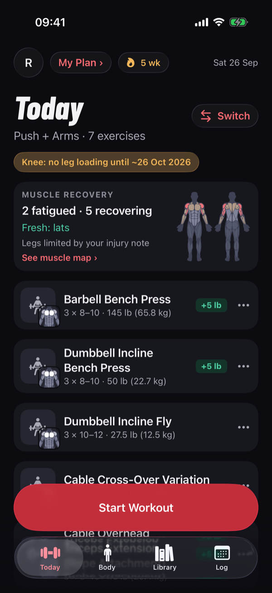
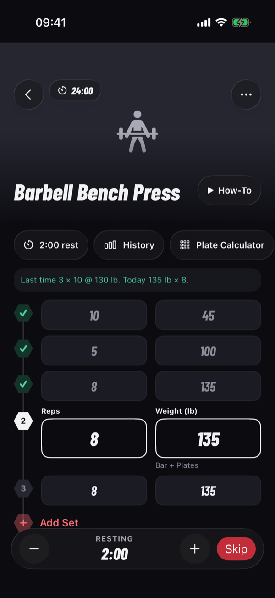
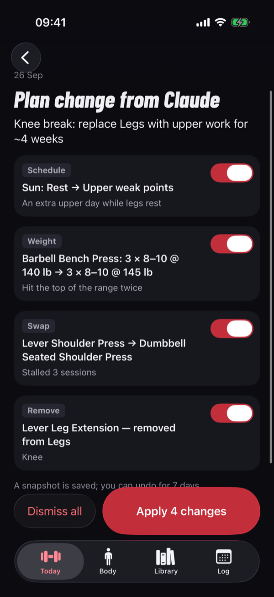
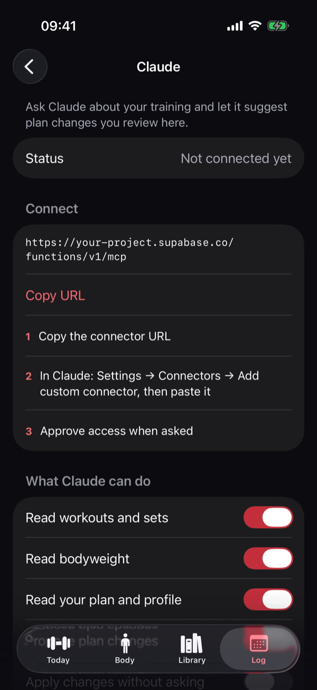
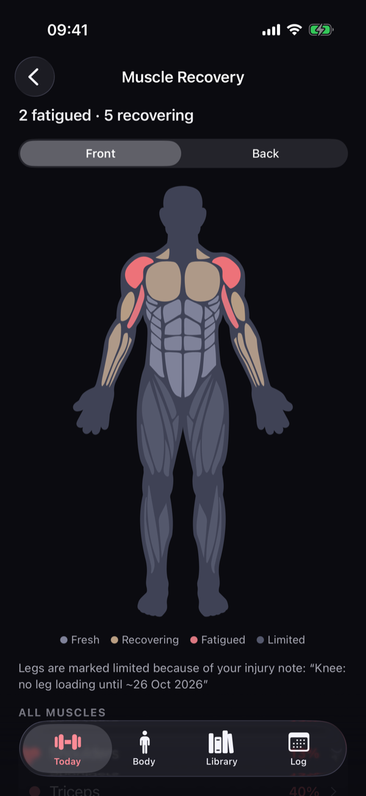
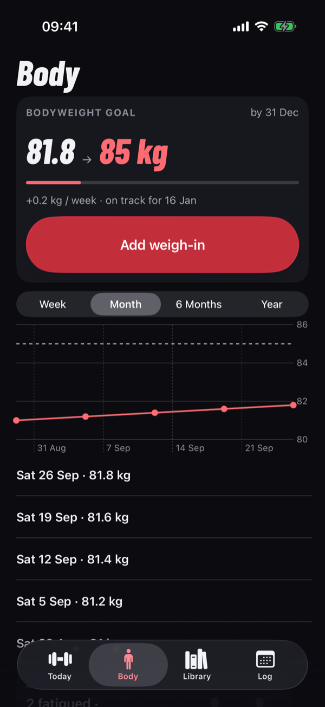
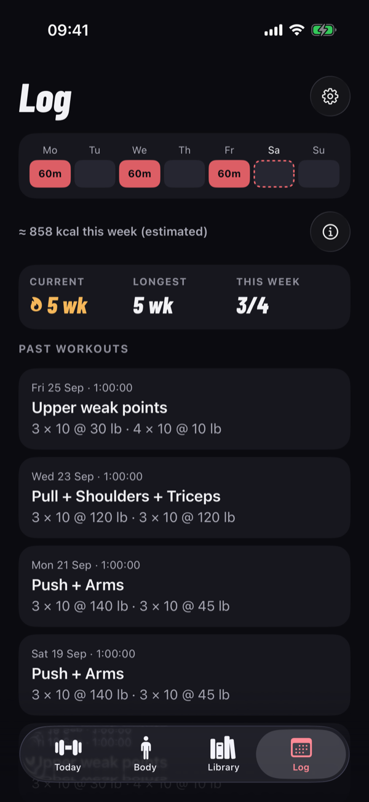

# GymRollins

**An open-source, native iPhone and Apple Watch gym tracker that Claude can read and plan with, through MCP.**

<table>
  <tr>
    <td align="center"><br><sub>Today's plan</sub></td>
    <td align="center"><br><sub>Logging a workout</sub></td>
    <td align="center"><br><sub>Claude proposes, you approve</sub></td>
    <td align="center"><br><sub>Connect Claude via MCP</sub></td>
  </tr>
  <tr>
    <td align="center"><br><sub>Muscle recovery</sub></td>
    <td align="center"><br><sub>Bodyweight goal</sub></td>
    <td align="center"><br><sub>History and streaks</sub></td>
    <td></td>
  </tr>
</table>

<sub>Screenshots use the app's built-in demo data. Regenerate them with `scripts/readme-screenshots.sh`.</sub>

## Why I built it

I wanted an AI coach that knows my real training: every set, every weight, every skipped day. For that I needed a
native iOS workout app with an **MCP server**, so Claude could read my history directly and help plan the next
weeks. I couldn't find one.

So I built my own: a fast, native SwiftUI app for logging in the gym, with a remote MCP server that lets Claude
read your training and **propose** plan changes. Claude never edits your plan directly; you review each proposal
in the app and apply it with one tap.

Now I'm open-sourcing it so we can build it together. If you've also been looking for an AI-ready workout app,
try it, open an issue, or send a pull request.

## What it does

- **Plan and log workouts.** Routines on a weekly schedule, weight suggestions from a progression engine, plate
  rounding, rest timer, supersets, and a one-tap "reps left" effort rating.
- **Claude as your coach, via MCP.** Add GymRollins as a custom connector in Claude (OAuth 2.1 with dynamic client
  registration, no API keys to copy). Claude reads your history and proposes changes; you approve them in the app.
- **Apple Watch.** Log sets from the wrist, rest timer with haptics, heart rate during the workout.
- **Apple Health.** Workouts and weigh-ins go to Health; body weight comes back from it.
- **Insights.** Muscle recovery map, weekly sets per muscle, streaks, and strength levels compared with
  OpenPowerlifting data.
- **Bring your history.** CSV import from Fitbod, Strong, Hevy and FitNotes.
- **Offline-first.** Everything lives on the device (SwiftData); cloud sync through Supabase is optional.

## Status

Early, and built for one user first (me). It runs today on the simulator or your own iPhone against a local
Supabase stack. Hosted cloud sync and an App Store release are next; see `docs/release-readiness.md` for what works
and what's still missing.

## Build it with me

Good places to start:

- More importers (other apps' CSV exports) and better exercise matching.
- New MCP tools for Claude: what would you want your AI coach to read or propose?
- Exercise photos and media with clear licenses.
- Apple Watch and Apple Health features, accessibility, and translations.

Open an issue to discuss an idea first, or pick an existing one. Contributions need a one-time CLA signature; see
[CONTRIBUTING](.github/CONTRIBUTING.md).

## Developer docs

Native SwiftUI iOS app + Supabase backend + remote MCP server. Offline-first: SwiftData is the source of truth on
the device and cloud sync is best-effort. Claude reads training data and *proposes* plan changes through MCP; it
never edits the plan directly. The owner applies proposals in the app (or opts in to auto-apply).

- Spec: `docs/specs/2026-09-26-gymrollins-ios-design.md`
- Plans: `docs/plans/`
- Mockups: `docs/design/`
- Release readiness: `docs/release-readiness.md` — what works locally, what needs the cloud
  project, what's deferred, owner decisions needed, install instructions
- Cloud checklist: `docs/cloud-checklist.md` — settings to change before pointing a build at a
  cloud Supabase project
- Flow-map test coverage: `docs/testing/flow-coverage.md`
- Performance baselines: `docs/testing/performance.md`

## Architecture

```
┌──────────────── iPhone ────────────────┐        ┌──────────── Supabase ─────────────┐
│ SwiftUI features (Today, Workout, Log, │        │ Postgres (RLS by auth.uid())       │
│ Body, Library, Settings, Onboarding)   │        │ Auth: Apple ID token, OAuth 2.1     │
│        │ observes                      │  sync  │   server (+ DCR) for MCP clients   │
│ GymData: SwiftData store + SyncEngine ─┼───────►│ PostgREST (tables, RPC)            │
│        │ uses                          │        │ Edge Fn `mcp` (MCP tools)  ◄───────┼── Claude (custom
│ GymCore: pure Swift domain & rules     │        │                                     │    connector)
└────────────────────────────────────────┘        └────────────────────────────────────┘
```

| Package / dir | What lives there |
|---|---|
| `ios/GymRollins/` | App target: entry point, `Features/*` (SwiftUI screens), `DesignSystem/*` (Liquid Glass components, tokens), `Resources/` (exercise library JSON, fonts) |
| `ios/GymRollinsTests/`, `ios/GymRollinsUITests/` | App-level unit + XCUITest E2E suites |
| `ios/Packages/GymCore/` | Pure Swift domain: models, progression engine, 1RM, plate rounding, CSV import (Fitbod, Strong, Hevy, FitNotes behind `WorkoutImporter`; plan 13), plan-change validation — no I/O |
| `ios/Packages/GymData/` | SwiftData schema, repositories, `SyncEngine`, Supabase client wrapper |
| `ios/Packages/GymSync/` | Sync DTOs, transport (real + fake for tests), auth service |
| `ios/Packages/GymHealth/` | Apple Health: `HealthStore` seam (HealthKit + fake), workout/weigh-in export, body import (plan 15) |
| `ios/Packages/GymWatchLink/` | Phone ↔ Apple Watch link (plan 17): versioned WatchConnectivity messages, the watch's view model, Digital Crown stepping, single-Health-workout rules — Foundation only, builds for watchOS 10 |
| `ios/GymRollinsWatch/` | Apple Watch app (watchOS 10, `com.rollins.gymrollins.watchkitapp`): live set + Log set, rest timer with haptic, `HKWorkoutSession` heart rate. See "Apple Watch" below |
| `web/consent/` | The OAuth consent page Claude's connector redirects to (static site: `index.html`/`consent.js`/`style.css`), served locally by `scripts/consent-server.mjs` — **not** a Supabase Edge Function, since Supabase rewrites Edge Function HTML responses to `text/plain` (`docs/research/2026-09-26-mcp-on-supabase.md` §5) |
| `supabase/` | `config.toml` (local auth/OAuth server config), `migrations/*.sql` (schema, RLS, RPCs), `seed.sql` (exercise library + test users, local only), `functions/mcp/` (the MCP Edge Function: tools, auth, rate limiting, audit) |
| `scripts/` | Everything below — stack lifecycle, test runners, one-off generators |

MCP: a remote Streamable-HTTP MCP server as a Supabase Edge Function, authenticated via Supabase
Auth's OAuth 2.1 server with dynamic client registration (Claude registers itself as a client, no
manual API key setup). AI writes go through **proposals**: Claude calls MCP tools to read
training data and create a proposal; the owner reviews and applies it in the app (or turns on
auto-apply). Consent for a newly registered OAuth client is never automatic — see "OAuth (Claude
connector)" below.

## Quick start

```sh
# 1. Local Supabase stack (Docker via colima; writes supabase/.env.local, gitignored)
scripts/supabase-up.sh

# 2. Generate the Xcode project and run the app (needs Xcode 26.3+, iOS 26 SDK)
cd ios && xcodegen generate
open GymRollins.xcodeproj   # run on the iPhone 17 Pro simulator, or see docs/release-readiness.md
                             # "How to install on your iPhone" for a physical device

# 3. Run the tests that don't need Docker
scripts/ios-test.sh
```

Cloud sync isn't required to use the app — SwiftData is the offline source of truth and the app
works fully offline. `Local.xcconfig` (gitignored, `ios/Config/`) overrides the local-stack
defaults in `Base.xcconfig` with a signing team and, later, cloud Supabase credentials; see
`docs/cloud-checklist.md`.

## Test

| Suite | Command |
|---|---|
| Everything (Docker suites opt-in: `SYNC_E2E=1`, `MCP_E2E=1`, `PHOTO_E2E=1`) | `scripts/test-all.sh` |
| GymCore unit tests | `cd ios/Packages/GymCore && swift test` |
| GymCore coverage (≥ 90%) | `scripts/coverage-gymcore.sh` |
| GymData unit tests | `cd ios/Packages/GymData && swift test` |
| GymSync unit tests (fake transport) | `cd ios/Packages/GymSync && swift test --filter GymSyncTests` |
| iOS app unit + UI tests | `scripts/ios-test.sh` |
| GymHealth unit tests (fake Health store) | `cd ios/Packages/GymHealth && swift test` |
| GymWatchLink unit tests (messages, crown, Health dedupe rules, watch view model) | `cd ios/Packages/GymWatchLink && swift test` |
| Apple Watch app builds (watchOS simulator + device, unsigned; no watchOS runtime needed) | `scripts/watch-build.sh` |
| MCP validator, tools and endpoint (deno, `FakeDb`; includes the domain-limits drift guard, `_shared/domain-limits-drift.test.ts`) | `cd supabase/functions && deno test --allow-read _shared/ mcp/` |
| OAuth consent server unit tests | `node --test web/consent/server.test.mjs` |
| Exercise photo matcher (free-exercise-db mapping) | `node --test scripts/map-exercise-photos.test.mjs` |
| wger photo + other-language name mapper (per-item CC licenses, provenance policy; review: `docs/import/wger-review.md`) | `node --test scripts/map-wger.test.mjs` |
| Strong / Hevy / FitNotes alias tables (ids exist, no key collisions, every override explained; review: `docs/import/other-apps-alias-review.md`) | `node --test scripts/other-apps-alias-report.test.mjs` |
| Body-map extractor (react-native-body-highlighter paths → `Resources/body-map.json`) | `node --test scripts/build-body-map.test.mjs` |
| Strength-standards builder (OpenPowerlifting CSV → `Resources/strength-standards.json` + the MCP copy; regenerate: `docs/licenses/openpowerlifting.md`) | `node --test scripts/build-strength-standards.test.mjs` |
| Photo prompts + Gemini photo generator (mocked fetch, no API calls; how to run it: `docs/media/README.md`) | `node --test scripts/build-photo-prompts.test.mjs scripts/generate-photos.test.mjs` |
| Photo uploader to Supabase Storage (mocked Storage API) | `node --test scripts/upload-photos.test.mjs` |
| Photo hosting E2E (local Supabase Storage: upload script -> manifest -> app provider; needs Docker) | `scripts/test-photo-hosting.sh` |
| Database tests (pgTAP; **resets the local `gymrollins` DB**) — needs the local stack up (`scripts/supabase-up.sh`) | `scripts/test-db.sh` |
| MCP HTTP e2e + OAuth consent e2e in headless Chromium — needs Docker/local stack (starts `supabase functions serve mcp` and `consent-server.mjs` itself if not already running; one-time `cd web/consent && npm ci && npx playwright install chromium`) | `scripts/test-mcp.sh` |
| GymSync integration tests (`GymSyncIntegrationTests`) against the local stack — needs `scripts/supabase-up.sh` already run (`supabase/.env.local` present); verifies account deletion leaves no rows | `scripts/test-sync-integration.sh` |
| iOS sync E2E UI tests (`SyncUITests`, `ProposalSyncUITests`) — starts the local stack itself, needs the iOS 26 simulator (`iPhone 17 Pro`) | `scripts/ios-test-sync.sh` |
| Performance baselines (not in test-all; GymData repository timings + iOS launch/scroll metrics, release build + simulator) | `scripts/test-perf.sh [data\|ui]` — see `docs/testing/performance.md` |

## Apple Watch

A companion watch app (plan 17, `docs/plans/2026-09-30-plan-17-watch.md`) for **watchOS 10+** (the owner's Series 5
runs watchOS 10.6.1). The iPhone stays the source of truth: while a workout runs on the phone, the watch shows the
next set ("Set 3/5 · 135 lb × 8"), rest countdown (haptic at 0), workout clock and heart rate; it can Log set (Digital
Crown adjusts weight by the phone's plate/dumbbell increment, and reps), +30s / Skip rest, move between exercises, and
start today's workout. The watch's `HKWorkoutSession` saves the Health workout (heart rate, measured energy) and the
phone then doesn't export its own copy — one Health workout per workout.

**Install on the watch** (needs Xcode signed in with the team's Apple ID, and the watchOS platform installed in Xcode →
Settings → Components — ~5 GB, required to deploy to any watch):

```sh
cd ios && GYM_EMBED_WATCH=YES xcodegen generate   # embeds the watch app in the iPhone app (off by default)
open GymRollins.xcodeproj
```

Run the `GymRollins` scheme on the iPhone paired with the watch; then on the iPhone open the Watch app → My Watch →
Available Apps → GymRollins → Install (or run the `GymRollinsWatch` scheme on the watch directly). Open GymRollins on
the watch once to allow Health access. Without `GYM_EMBED_WATCH=YES` the project builds and tests without the watchOS
platform (Xcode refuses to build a scheme with an embedded watch app when it's missing).

## OAuth (Claude connector)

Claude connects to GymRollins as an OAuth 2.1 client of Supabase's built-in authorization server
(`[auth.oauth_server]` in `supabase/config.toml`). Supabase rewrites Edge Function HTML responses to `text/plain`
(`docs/research/2026-09-26-mcp-on-supabase.md` §5), so the consent screen users approve/deny on can't be the `mcp`
Edge Function itself — it's a static site instead.

- **`web/consent/`** — the consent page (`index.html`, `consent.js`, `style.css`). Reads `authorization_id` from
  the query string, signs the user in if needed (email/password locally; Apple only when the cloud build sets
  `window.GYM_APPLE_ENABLED`), calls `supabase.auth.oauth.getAuthorizationDetails`, shows the client name, the
  full redirect URI (monospace) and a first-time warning, then Approve/Deny → `approveAuthorization`/`denyAuthorization` → follows the returned
  `redirect_url`. Loads `supabase-js` from `https://esm.sh/@supabase/supabase-js@2.117.2` (pinned).
- **`scripts/consent-server.mjs`** — serves `web/consent/*` on `http://127.0.0.1:55430` (binds to `127.0.0.1`
  only), maps `/oauth/consent` (and `/`) to `index.html`, and generates `/config.js`
  (`window.GYM_CONFIG = { url, anonKey }`, `Cache-Control: no-store`) from `supabase/.env.local` — **never** the
  service-role key. Assets are referenced root-relative (`/style.css`, `/config.js`, `/consent.js`). Sets a strict
  CSP (`default-src 'self'; script-src 'self' https://esm.sh; style-src 'self'`, no `'unsafe-inline'`,
  `connect-src` scoped to exactly the local API URL) and `X-Content-Type-Options: nosniff`, and blocks directory
  traversal. Run it directly with `node scripts/consent-server.mjs`.
- **`scripts/oauth-local-smoke.sh`** — automates the whole local OAuth handshake except the human's "Approve"
  click: Dynamic Client Registration, PKCE, hits the authorize endpoint, starts a tiny listener on
  `127.0.0.1:8976` to catch the callback, prints the consent URL to open, then exchanges the code and calls the
  MCP endpoint's `tools/list` with the resulting token. It starts `consent-server.mjs` and
  `supabase functions serve mcp` if they aren't already running, and stops only what it started. Run:
  `scripts/oauth-local-smoke.sh` (set `SMOKE_TIMEOUT=<seconds>` to change how long it waits for the click,
  default 300).

### Auth config changes need a stack restart

`GET /auth/v1/oauth/authorize` redirects to `[auth] site_url` (`http://127.0.0.1:55430`, where
`consent-server.mjs` listens) + `/oauth/consent?authorization_id=...`. The auth container reads `config.toml` only
when it starts: restart the stack after `config.toml` changes (`npx --yes supabase@2.118.0 stop`, then
`scripts/supabase-up.sh`) and check with `docker exec supabase_auth_gymrollins env | grep SITE_URL`.

The whole flow including the click runs automated in headless Chromium: `web/consent/e2e.test.mjs` (DCR →
authorize → consent page → sign in → Approve → redirect with `code` → PKCE token exchange), part of
`scripts/test-mcp.sh` (one-time setup: `cd web/consent && npm ci && npx playwright install chromium`).
The full "add custom connector" flow inside the claude.ai/Desktop app needs public HTTPS and can't be tested
locally; see `docs/release-readiness.md` ("Needs the cloud project") and `docs/cloud-checklist.md`.

## License

GymRollins is open source under the [GNU AGPLv3](LICENSE), on the same model as
[Twenty](https://github.com/twentyhq/twenty):

- Everything is AGPLv3 except files marked `@license Pro` at the top. Those are under the GymRollins
  Commercial License (end of [LICENSE](LICENSE)) and need a GymRollins Pro subscription for production use.
- Third-party data and assets keep their own licenses: `docs/licenses/` and
  `ios/GymRollins/Resources/CREDITS.md`.
- The name and logo are not covered by the code license: [.github/TRADEMARK.md](.github/TRADEMARK.md). Forks
  need their own name, icon and bundle identifier.
- Contributions need a one-time [CLA](.github/CLA.md) signature; see [CONTRIBUTING](.github/CONTRIBUTING.md).
